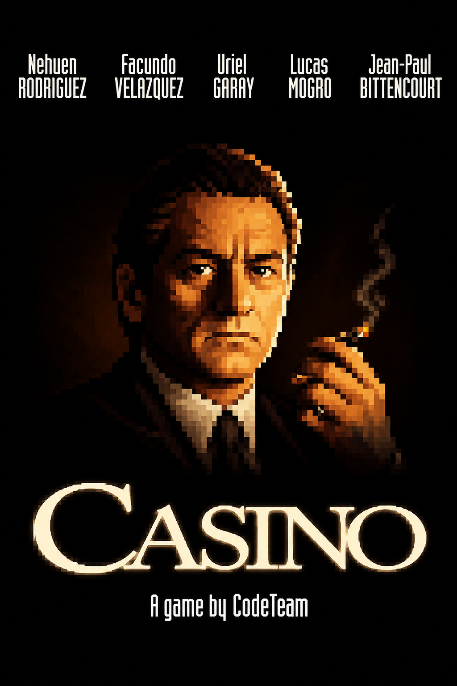

# Casino

## Equipo de desarrollo

- Nehuen Rodriguez  
- Facundo Velazquez  
- Uriel Garay  
- Lucas Mogro  
- Jean-Paul Bittencourt

## Capturas

<section align = "center", id = "controles">
       
</section>    

## Reglas de Juego / Instrucciones

El jugador comienza la partida con una cantidad inicial de dinero.

El objetivo del juego es alcanzar los **$2000.**

Juegos:

Juego 1: Lluvia de cartas.

        En este juego la consigna es esquivar cartas que caen constantemente y que por cada carta que golpee al jugador, este perderá dinero.

        Existen dos tipos de cartas, el primer tipo irá a una velocidad normal y quitará un valor menor de dinero y la otra irá más rápido y quitará más dinero.

        El enemigo principal estará lanzando las cartas desde arriba.

        El protagonista irá acumulando dinero a medida que pase el tiempo, llegando al límite de dinero que se pueda ganar en el juego al terminar el tiempo de juego.
        Ejemplo -> Duración: 30 segundos
        Dinero inicial de la partida: $100
        Cada segundo sobrevivido: +$10
        Carta normal: -$25
        Carta rápida: -$50
        Máximo que puede obtener: $400

Juego 2: Dado de la suerte.

        Este juego trata de lanzar un dado y apostar al resultado que saldrá en diferentes posibles rangos.

        Se podrá elegir una de las siguientes opciones: 
        1. Un número específico desde 1 al 6.
        2. Si es par o impar.
        3. Si es mayor a 3.
        4. Si es menor/igual a 3.
                                                
        El protagonista obtendrá dinero dependiendo de si sale su opción elegida o no, y dependiendo de cuál opción sea, es la cantidad de dinero obtenido; 
        1. X5 de dinero.
        2. X1.8 de dinero.
        3. X1.8 de dinero.
        4. X1.8 de dinero.

Juego 3: Sigue el vaso.

        Este juego consiste en tres vasos que inicialmente mostrarán cual de los 3 tienen la recompensa, luego intercambiarán de posición cierta cantidad de veces para finalmente tener que adivinar en cual está dicha recompensa.

        Antes de empezar, el jugador elige cuánto apostar: $50, $100 o $200 (no puede apostar más dinero del que tiene).

        Existirá solamente una recompensa.

        Si el jugador acierta, gana el monto que apostó y ese dinero se suma al que ya tenía.
        Si no acierta, pierde el monto que apostó.

        Ejemplos:
        Apuesta $50  -> acierta: +$50  / falla: -$50
        Apuesta $100 -> acierta: +$100 / falla: -$100
        Apuesta $200 -> acierta: +$200 / falla: -$200

## Otros

- Curso/Facultad: UNAHUR - Universidad Nacional de Hurlingham
